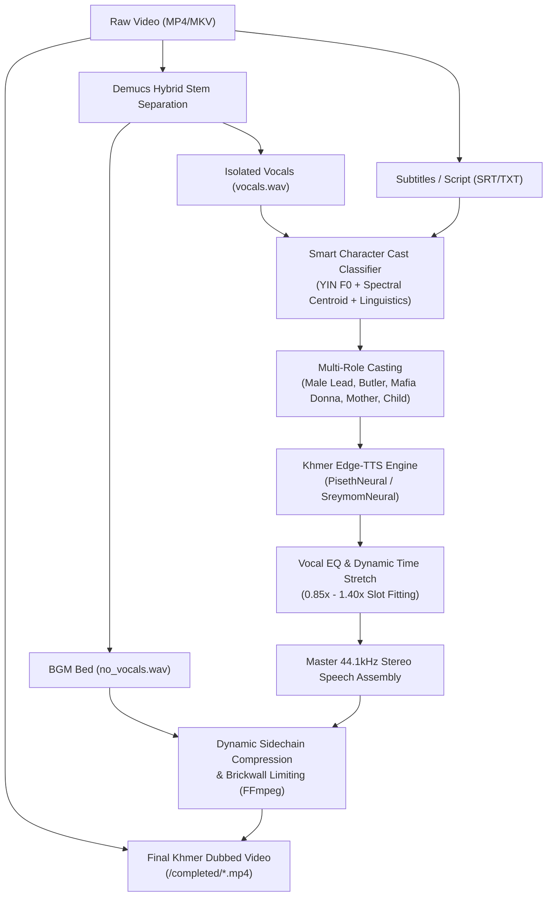

# 🎙️ VANTA Khmer AI Dubbing Studio

An advanced, automated, and interactive AI dubbing workstation tailored for dubbing short dramas and video content into natural Khmer speech. Features Demucs stem isolation, deep acoustic voice role classification (YIN $F_0$ pitch tracking), multi-character Edge-TTS synthesis, sample-accurate timeline stitching, dynamic sidechain ducking, and a Descript/CapCut-style web editor.

---

## 🌟 Key Highlights

- **Deep Acoustic Voice Role Classifier**: Analyzes the vocal stem using `librosa.yin` fundamental frequency ($F_0$) tracking, Spectral Centroid (timbre brightness), and RMS energy to automatically identify roles (Male Lead, Butler, Mafia Donna, Mother, Child) regardless of incorrect or missing subtitle tags.
- **Stem Separation with Demucs**: Automatically separates source audio into isolated dialogue (`vocals.wav`) and pristine background music beds (`no_vocals.wav`).
- **Khmer Neural TTS Prosody Engine**: Generates character voices with Microsoft Edge-TTS (`km-KH-PisethNeural` and `km-KH-SreymomNeural`) customized with character-specific pitch, speaking rate, and volume offsets.
- **Content-Signature Cache Hashing**: Dialogue line edits trigger instant fresh synthesis via MD5 signature hashing (`text|voice|rate|pitch|volume`) while unedited lines reuse cache, guaranteeing instantaneous re-dubs.
- **Dynamic Sidechain Ducking**: Automatically ducks the background music bed whenever dialogue is active with configurable compression ratio, attack, release, and brickwall peak limiting.
- **Descript/CapCut Style Web Studio**: Responsive dark-mode interface built with Tailwind CSS and DaisyUI featuring live audio auditioning, real-time subtitle editing, dual-player preview (Source vs. Dubbed), and episode browsing.
- **Clean Folder Architecture**: Organized directory structure keeping completed MP4s, master speech WAVs, stems, and edited subtitles neatly separated.

---

## 🏗️ Architecture Pipeline



---

## 🎭 Character Voice Presets

| Role | Default Character | Voice Engine | Pitch Offset | Rate Offset | Description |
|---|---|---|---|---|---|
| **Male Lead** | Lucas / Narrator | `km-KH-PisethNeural` | `-2Hz` | `+0%` | Calm, deep, resonant narrator voice |
| **Butler** | Housekeeper / Coordinator | `km-KH-PisethNeural` | `-6Hz` | `+1%` | Dignified, authoritative, deep bass tone |
| **Mafia Donna** | Serafina / Female Lead | `km-KH-SreymomNeural` | `-3Hz` | `-2%` | Elegant, commanding, steady executive tone |
| **Mother** | Ex-Wife / Mother | `km-KH-SreymomNeural` | `+0Hz` | `-3%` | Emotional, dramatic adult female voice |
| **Child** | Marco / Young Child | `km-KH-SreymomNeural` | `+5Hz` | `+6%` | High-pitched, playful, delicate child timbre |

---

## 📂 Project Directory Structure

```text
Dubbed/
├── completed/            # Final multiplexed Khmer Dubbed MP4 videos
├── master_speech/        # Assembled sample-accurate 44.1kHz stereo speech WAVs
├── stems/                # Demucs separated stems (vocals.wav & no_vocals.wav)
├── subtitles/            # Saved translated & role-assigned SRT files (*_edited_km.srt)
├── studio_cache/         # Temporary audio synthesis chunks and previews
├── uploads/              # Uploaded drama videos and scripts
├── static/
│   └── index.html        # Web Studio UI (Tailwind CSS + DaisyUI + Lucide Icons)
├── server.py             # FastAPI backend server and media streaming API
├── studio_core.py        # Core DSP, TTS, Demucs, and multiplexing engine
├── run_studio.bat        # Windows one-click studio launcher
├── requirements.txt      # Python dependencies
├── .gitignore            # Git ignore configuration
└── README.md             # Project documentation
```

---

## 🚀 Prerequisites & Installation

### 1. System Requirements
- **Operating System**: Windows 10/11, Linux, or macOS
- **Python**: Python 3.10, 3.11, or 3.12
- **FFmpeg**: Must be installed and accessible in your system `PATH`
  ```bash
  ffmpeg -version
  ```
- **GPU (Optional)**: NVIDIA GPU with CUDA enabled accelerates Demucs stem separation (~10-20x faster than CPU).

### 2. Clone Repository
```bash
git clone https://github.com/your-username/khmer-ai-dubbing-studio.git
cd khmer-ai-dubbing-studio
```

### 3. Install Dependencies
```bash
pip install -r requirements.txt
```

---

## 🎬 Running the Studio

### Quick Launch (Windows)
Double-click `run_studio.bat`, or run from PowerShell / Command Prompt:
```bash
run_studio.bat
```

### Manual Launch
```bash
python server.py
```
Open your browser and navigate to:
```
http://127.0.0.1:7860
```

---

## 🛠️ Workflow Walkthrough

1. **Select or Upload Episode**:
   - Click **"Open Episode"** to browse downloaded drama episodes, or drag and drop a new video into the upload area.
2. **Load or Paste Dialogue Script**:
   - The studio automatically matches local `.srt` or `.txt` scripts. You can also click **"Paste Raw Text"** to import any translation directly.
3. **Auto-Classify Roles**:
   - Click **"Auto-Classify Roles"**. The engine extracts acoustic $F_0$ pitch and spectral harmonics from the vocal track and classifies each dialogue line into its character role.
4. **Interactive Audition & Edits**:
   - Click **"Audition"** on any dialogue card to immediately hear the line synthesized with its assigned role and prosody.
   - Edit the Khmer text or change character roles directly in the card.
5. **Adjust Audio Mixing**:
   - Fine-tune **Dialogue Boost**, **BGM Bed Volume**, and **Ducking Depth (Sidechain Ratio)**.
   - Use **"Re-Mix Audio Track"** for instantaneous 1-second audio re-mixing without re-synthesizing voices.
6. **Full Dub Video**:
   - Click **"Full Dub Video"**. The engine synthesizes speech, fits timeline durations, ducks BGM, multiplexes lossless video, and stores the completed video in `/completed`.

---

## 🔌 API Endpoints Reference

| Method | Endpoint | Description |
|---|---|---|
| `GET` | `/` | Serves the interactive Web Studio UI |
| `GET` | `/api/library` | Scans and lists drama series and episodes with stem/dub status |
| `POST` | `/api/load_file` | Loads a video and subtitle file into active studio memory |
| `POST` | `/api/upload_video` | Uploads an episode video file to `/uploads` |
| `POST` | `/api/paste_subtitles` | Parses pasted raw subtitle text with auto-classification |
| `POST` | `/api/save_subtitles` | Exports edited subtitles to `/subtitles/{stem}_edited_km.srt` |
| `POST` | `/api/auto_classify` | Executes deep acoustic & linguistic character classification |
| `POST` | `/api/separate_stems` | Runs Demucs isolation on the active video |
| `POST` | `/api/audition` | Generates a quick single-line audition MP3 |
| `POST` | `/api/remix` | Rapidly re-mixes existing speech master and BGM stems (~1.5s) |
| `POST` | `/api/run_pipeline` | Full end-to-end pipeline (Stems → Synthesis → Mix → Mux) |
| `GET` | `/api/completed` | Lists all completed dubbed video files with file size and timestamp |
| `GET` | `/media/dubbed_video` | Streams completed dubbed video with cache-busting headers |
| `GET` | `/media/source_video` | Streams original source video |

---

## 📄 License

This project is licensed under the [MIT License](LICENSE).
